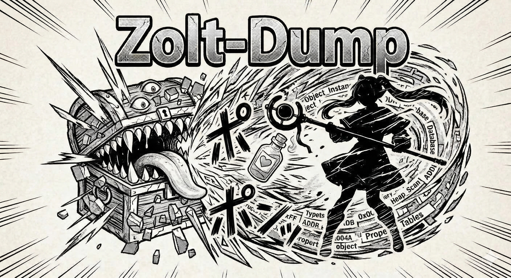

# Zolt-Dump

Real-time Godot Engine memory dumper and analyzer with Cheat Engine integration.

Named after **Zoltraak** (ゾルトラーク) — Frieren's signature attack magic that deconstructs its target.



---
[](https://www.microsoft.com/windows)
[](https://dotnet.microsoft.com/)
[](https://avaloniaui.net/)
[](LICENSE)
[](https://claude.ai/code)

## Features

- **Real-time object inspection** — Browse Godot's ObjectDB, ClassDB, and SceneTree live in-memory
- **Live property values** — Read object properties at runtime via direct memory access with auto-refresh
- **Container drilldown** — Navigate into Array, Dictionary, and PackedArray elements with pagination
- **GDScript member support** — Enumerate and read GDScript/C# script instance members alongside native properties
- **.NET/C# managed object support** — Detect .NET Godot games, probe CSharpInstance layout, bulk-scan managed instances with node name + field value filtering, auto-discover MethodTable across game restarts
- **Node tree hierarchy** — Navigate the complete scene tree with breadcrumb navigation and parent traversal
- **Property search** — Cross-class keyword search with live value preview enrichment
- **Class browser** — Filter and inspect ClassDB entries with inline property detail panel
- **Instance finder** — Locate all live instances of any class with address lookup
- **Cheat Engine integration** — CE Lua AA scripts for both native offsets and GDScript members, CE XML export, CSX Structure Dissect
- **AOBMaker integration** — Generate AA code, create memory records, goto dump address
- **Proxy DLL injection** — winmm.dll proxy with 180 MASM trampolines for seamless loading
- **Multi-version support** — Godot 3.x (3.5+) and Godot 4.x (4.0 ~ 4.7+)

## Compatibility

| Godot Version | ObjectDB | ClassDB | SceneTree | Property Walk |
|---------------|----------|---------|-----------|---------------|
| 4.0 (GCC)     | ✅       | ✅      | ✅        | 68/96 values  |
| 4.1 (GCC)     | ✅       | ✅      | ✅        | 72/101 values |
| 4.2 (MSVC)    | ✅       | ✅      | ✅        | 86/104 values |
| 4.3 (MSVC)    | ✅       | ✅      | ✅        | 92/111 values |
| 4.4.x         | ✅       | ✅      | ✅        | ✅            |
| 4.5.x         | ✅       | ✅      | ✅        | ✅            |
| 4.6.x         | ✅       | ✅ (AHashMap) | ✅   | ✅            |
| 3.5+ (GCC)    | ✅       | ✅      | ✅        | 41/52 values  |

Tested with official editors (4.0–4.6.1) and real games including Brotato (3.7dev), Magic Archery (4.2.2), One Potion Please (4.3), Upload Labs (4.5.1rc2), Holo X Break (4.2), Dome Keeper (4.2.2).

## Architecture

```
Game Process (Godot 3.x / 4.x)      ZoltDumpUI (Avalonia)
+-------------------------------+    +---------------------------+
| ZoltDumper.dll [injected]     |    | LiveWalkerPanel           |
|   Frieren  (OffsetFinder)     |    |   Container drilldown     |
|   Ausetiese (ObjectDB)        |    |   CE Lua script gen       |
|   Diagoldze (ClassDB)         |pipe|   Auto-refresh            |
|   Serie    (SceneTree)        |<-->| InstanceFinderPanel       |
|   Ubel     (PropertyWalker)   |    | PropertySearchPanel       |
|   Flamme   (StringName)       |    |   Live value enrichment   |
|   Heiter   (GameThread)       |    | NodeFilterPanel           |
|   Qual     (Mailbox IPC)      |    |   Class property detail   |
|     +-- .NET managed scan    |    |     +-- Node name filter  |
|   Eisen    (Proxy DLL)        |    | NodeTreePanel             |
+-------------------------------+    | ClassStructPanel          |
                                     | PointerPanel              |
                                     | ProxyDeployPanel          |
                                     | CE XML/CSX/SDK Export     |
                                     | AOBMaker Bridge           |
                                     +---------------------------+
```

## UI Panels

| Panel | Description |
|-------|-------------|
| **Live Walker** | Real-time property drilldown with breadcrumb navigation, container element browsing, CE Lua script generation (native offsets + GDScript members + .NET managed), auto-refresh |
| **Instance Finder** | Search for all live instances of a class, address lookup with L2 alternatives for shared .NET objects, navigate to Live Walker |
| **Property Search** | Cross-class keyword search for properties by name, async live value preview, double-click to open in Live Walker |
| **Node Filter** | ClassDB browser with super-class filtering, inline property detail panel, context menu navigation |
| **Node Tree** | Full scene tree object listing with filtering and pagination |
| **Class Struct** | ClassDB property + method definitions for any class |
| **Pointers** | Global pointer display (Engine, ObjectDB, ClassDB, SceneTree) with AOBMaker integration |
| **Proxy Deploy** | Proxy DLL deployment manager for game directories |

## CE Integration

Zolt-Dump provides multiple Cheat Engine workflows:

- **CE Lua AA Scripts** — Right-click any property in Live Walker to generate Auto Assembler scripts. Native properties use `FIND_NODE + direct offset`. GDScript members use `FIND_NODE + GET_MEMBER_ADDR` mailbox IPC. .NET managed objects use `FIND_MANAGED_INSTANCES` with node name filtering and auto-discover MethodTable (scripts survive game restarts).
- **CE XML Export** — Pointer chain XML for importing into Cheat Engine tables
- **CSX Structure Dissect** — Structure definition export for CE's dissect view
- **AOBMaker Bridge** — Direct integration with AOBMaker for memory record creation
- **ZoltDump.CT** — Pre-built Cheat Table with Lua-based DLL injection

## Build

```powershell
# Build everything (DLL + UI + Tests)
.\build.ps1

# Build DLL only
.\build.ps1 -Target DLL

# Build proxy DLL (winmm.dll for game injection)
.\build.ps1 -Target ProxyDLL

# Build UI only
.\build.ps1 -Target UI

# Run tests
.\build.ps1 -Target Test

# Distribution build
.\build.ps1 -Mode Publish -Clean
```

**Requirements**: Visual Studio 2022+ (C++ Desktop workload), .NET 10 SDK

## Testing

215 unit tests covering export services, script generation, JSON parsing, and ViewModels:

| Test Suite | Tests | Coverage |
|------------|-------|----------|
| DumpServiceParseTests | 22 | JSON→Model parsing for all pipe commands, edge cases, payload verification |
| CeXmlExportServiceTests | 22 | CE XML type mapping (4.x + 3.x), composite expansion, hierarchy building |
| CeLuaScriptServiceTests | 38 | All 6 script types, mailbox offsets, symbol sanitization, Lua escaping |
| FieldValueConverterTests | 38 | real→Double, float/int/bool conversion, hex parsing, edge cases |
| NodeFilterViewModelTests | 16 | ApplyFilter, super/name filtering, class detail loading, navigation events |
| PropertySearchViewModelTests | 10 | Search, navigation, clipboard, INPC preview updates |
| CsxExportServiceTests | 11 | Scalar/composite fields, struct recursion, XML escaping |
| SdkExportServiceTests | 9 | C++ header generation, type mapping, padding, name sanitization |
| AddressHelperTests | 12 | Address formatting and normalization |
| KnownStructLayoutTests | 5 | Godot struct layout validation |
| VdfParserTests | 8 | Steam library path extraction |

```powershell
.\build.ps1 -Target Test
```

## Naming Convention

All modules use names from the anime *Frieren: Beyond Journey's End*:

| Module | Character | Role |
|--------|-----------|------|
| **Zoltraak** | 殺人魔法 (Attack Magic) | Memory scanning, AOB, SEH reads |
| **Frieren** | 芙莉蓮 (Protagonist) | Offset finder, AOB signatures |
| **Ausetiese** | 服從之秤 (Aura's Scales) | ObjectDB enumeration |
| **Diagoldze** | 黃金化 (Golden Transmutation) | ClassDB registry |
| **Serie** | 賽莉耶 (Living History) | SceneTree walker |
| **Ubel** | 尤蓓爾 (Assassin Specialist) | Property/variant reader |
| **Flamme** | 弗蘭梅 (Great Mage) | StringName resolver |
| **Fern** | 費倫 (Apprentice) | Named pipe server |
| **Stark** | 修塔爾克 (Brave Warrior) | C ABI export layer |
| **Heiter** | 海塔 (Priest) | Game thread dispatch |
| **Qual** | 庫瓦爾 (Elder Demon) | Mailbox IPC for CE scripts |
| **Eisen** | 艾冉 (Iron Warrior) | Proxy DLL forwarding |
| **Himmel** | 欣梅爾 (Hero) | Hint cache persistence |
| **Solitaer** | 索莉塔 (Concealment) | Logging system |

See [docs/naming-convention.md](docs/naming-convention.md) for the full guide.

## Documentation

| Document | Contents |
|----------|----------|
| [docs/architecture.md](docs/architecture.md) | Directory structure, vendor deps, build environment |
| [docs/dll-spec.md](docs/dll-spec.md) | C++ DLL interface, offset tables, CE Lua exports |
| [docs/pipe-protocol.md](docs/pipe-protocol.md) | Named Pipe JSON IPC protocol (20 commands) |
| [docs/export-formats.md](docs/export-formats.md) | CE XML, CSX, SDK Header export rules |
| [docs/godot-internals.md](docs/godot-internals.md) | Godot memory layout: ObjectDB, ClassDB, Variant, Node |
| [docs/naming-convention.md](docs/naming-convention.md) | Frieren naming guide with examples |
| [docs/technical-notes.md](docs/technical-notes.md) | Godot version differences, offset detection |
| [docs/dev-log.md](docs/dev-log.md) | Implementation status, challenges, next steps |

## Built with Claude Code

This project is developed with the assistance of [Claude Code](https://claude.ai/code) by Anthropic.

---

**License**: [MIT](LICENSE) © 2026 bbfox0703
